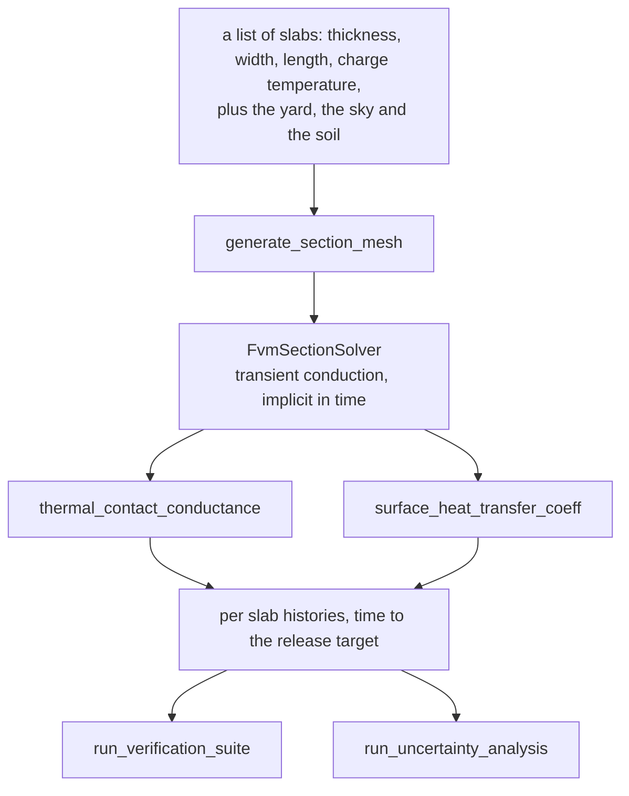

# Slab pile cooling simulation in an open slabyard

How long a stack of hot slabs holds its heat before a yard can release it. Transient conduction through
the whole pile, with the exposed faces, the weather, the ground under the bottom slab and the contact
between slab and slab.

One file runs it. `from-other/slab_piling_thermal_standalone.ipynb` carries the engine in its own eight
cells, so it needs nothing beside it.

## Run it

Colab already has numpy, scipy, pandas, matplotlib, plotly and ipywidgets, which is the whole import list.
A full run takes about three minutes: ten seconds per section solve, the rest in the uncertainty ensemble.

## The pile it ships with

Five slabs, mixed sizes, charged at 850 °C, in a 30 °C yard with 0.8 m/s of wind, a 25 °C sky, on soil
1.5 m deep. The yard releases at 50 °C.

| | |
| :--- | ---: |
| Pile clear, width section | 118.2 h |
| Pile clear, length section | 144.4 h |
| Monte Carlo P10, P50, P90 | 103.5, 114.5, 126.3 h |
| Energy balance, width and length | 0.92 and 0.15 per cent |

The top slab leaves first, because it has a face to the sky. The bottom one sits on soil that warms under
it, and that is the slab that sets the release date.

Two sections are solved rather than one, because a pile is not symmetric. Width by thickness carries the
overhangs and the soil contact, length by thickness carries the long path to the slab ends. The slower of
the two clears the pile.

## The route

## The equations

$$\rho\,c_p(\theta)\frac{\partial \theta}{\partial t} = \nabla \cdot \left(k(\theta)\nabla \theta\right)$$

$\theta$ temperature °C, $t$ time s, $\rho = 7850 - 0.35\theta$ kg/m³, and $k$ and $c_p$ from EN 1993-1-2 [1].
The apparent specific heat carries the transformation heat, 74 kJ/kg in the two peaked branches either side
of 735 °C, and stored energy is tracked through its analytical integral so the energy ledger is exact across
the peak.

Flux at an exposed face, a half cell of steel in series with the surface:

$$q = \frac{\theta_{cell} - \theta_{eff}}{\Delta/(2k) + 1/h_{total}}, \qquad
h_{total} = h_{conv} + h_{rad}, \qquad
h_{rad} = \varepsilon\sigma F\left(\theta_{s,K}^2 + \theta_{rad,K}^2\right)\left(\theta_{s,K} + \theta_{rad,K}\right)$$

$\Delta$ cell size normal to the face; $\theta_{eff}$ the sink blended by the weight of the two
coefficients; $\varepsilon$ 0.82 for oxidised mill scale; the radiation term in kelvin. Natural convection
is Churchill and Chu [2] on a vertical face and the Incropera laminar and turbulent coefficients [3] on a
horizontal one, with air properties at the film temperature. The wind term, $3.8\,V^{0.78}$ W/m²K for wind
speed $V$ in m/s, is an order of magnitude fit combined with the natural one in quadrature.

The joint, three paths in parallel and the mill scale in series:

$$h_c = \left[\frac{1}{h_s + h_g + h_r} + R_{scale}\right]^{-1}, \qquad
h_s = 1.25\,\frac{k_s\,m}{\sigma_a}\left(\frac{P}{H}\right)^{0.95}, \qquad
h_g = \frac{k_g}{Y + w}$$

$h_s$ the asperity path, after the Cooper, Mikic and Yovanovich model [6] with the coefficient as tabulated
in [7]; $h_g$ the gas path over the roughness separation $Y$ plus the waviness gap $w$; $h_r$ the radiation
across the gap; $P$ the weight of the stack above over the area that overlaps; $H(\theta)$ the hot hardness,
taken as an exponential fit falling from 1.5 GPa.

## Verification

| Check | Against | Result |
| :--- | :--- | :--- |
| Plate with convective faces | the analytical series solution [9] | 2.01 °C max, 1.51 °C rms over 850 to 50 °C |
| Energy, closed system | the analytical enthalpy ledger | 0.0000 per cent |
| Energy, the real pile | boundary flux against stored heat | 0.92 and 0.15 per cent |

## The uncertainty envelope

Twenty Latin hypercube samples over the parameters that are not measured on this steel: emissivity 0.76 to
0.86, joint roughness and waviness, scale thickness, wind, ambient temperature and the soil conductance.

| | h | |
| :--- | ---: | :--- |
| P10 | 103.5 | fastest plausible release |
| P50 | 114.5 | the number to schedule against |
| P90 | 126.3 | survives the worst plausible combination |

## Methods

- Python 3.14 with numpy, scipy sparse, pandas, matplotlib and plotly. Finite volume, implicit in time, one
  sparse solve per step.
- Headless execution, so the outputs that ship come from a run. Locally with nbconvert, or on Modal.
- It writes one file of its own, `slab_pile_cooling_history.csv`, the cooling curve of every slab.

## What it does not settle

- The joint conductance rests on a roughness, a hardness and a contact fraction that were not measured on
  this steel. The uncertainty run prices it.
- The wind term is an engineering fit. Published correlations for exterior surfaces scatter by a factor of
  two, which is why handbooks settle for an average film coefficient [8].
- A single sky temperature, no gusts, no rain, no scale growth, and the soil at constant properties.
- A slab is assumed to rest on the one below it. One bridging a gap would bend, and the joint model cannot
  express that.

## References

[1] British Standards Institution, *BS EN 1993-1-2: Eurocode 3, Design of Steel Structures, Part 1-2:
General Rules, Structural Fire Design*. London, U.K.: BSI, 2005, clauses 3.4.1.2 and 3.4.1.3, and
Table 3.1.

[2] S. W. Churchill and H. H. S. Chu, "Correlating equations for laminar and turbulent free convection from
a vertical plate," *International Journal of Heat and Mass Transfer*, vol. 18, no. 11, pp. 1323-1329, 1975.

[3] T. L. Bergman, A. S. Lavine, F. P. Incropera, and D. P. DeWitt, *Fundamentals of Heat and Mass
Transfer*, 7th ed. Hoboken, NJ, USA: Wiley, 2011, ch. 9 and Table A.4.

[4] The Engineering Toolbox, "Air properties: thermal conductivity vs. temperature and pressure,"
atmospheric pressure table. [Online]. Available:
https://www.engineeringtoolbox.com/air-properties-viscosity-conductivity-heat-capacity-d_1509.html

[5] F. M. White, *Viscous Fluid Flow*, 3rd ed. New York, NY, USA: McGraw-Hill, 2006, Sutherland's law for
the viscosity of gases.

[6] M. G. Cooper, B. B. Mikic, and M. M. Yovanovich, "Thermal contact conductance," *International Journal
of Heat and Mass Transfer*, vol. 12, no. 3, pp. 279-300, 1969.

[7] C. V. Madhusudana, *Thermal Contact Conductance*, 2nd ed. Cham, Switzerland: Springer, 2014.

[8] American Society of Heating, Refrigerating and Air-Conditioning Engineers, *ASHRAE Handbook:
Fundamentals*. Atlanta, GA, USA: ASHRAE, 2017, ch. 4 heat transfer, and ch. 25 on exterior surface film
coefficients, which are taken as averages because the wind at the surface is unknown.

[9] H. S. Carslaw and J. C. Jaeger, *Conduction of Heat in Solids*, 2nd ed. Oxford, U.K.: Oxford University
Press, 1959, ch. 3, series solutions for the plate.
