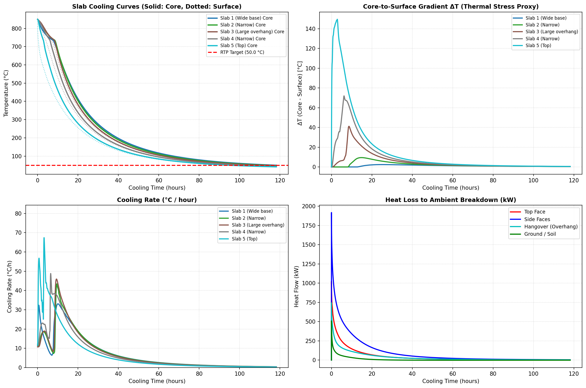
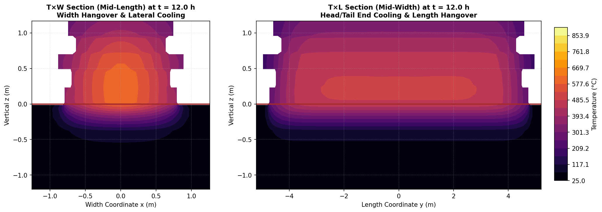
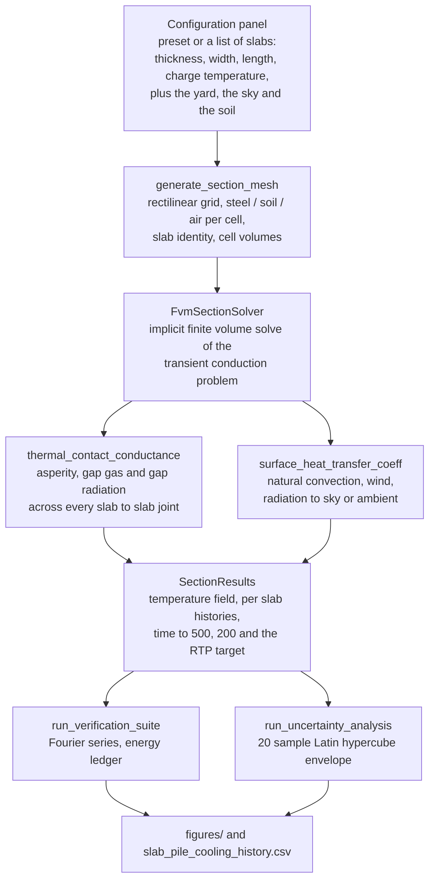
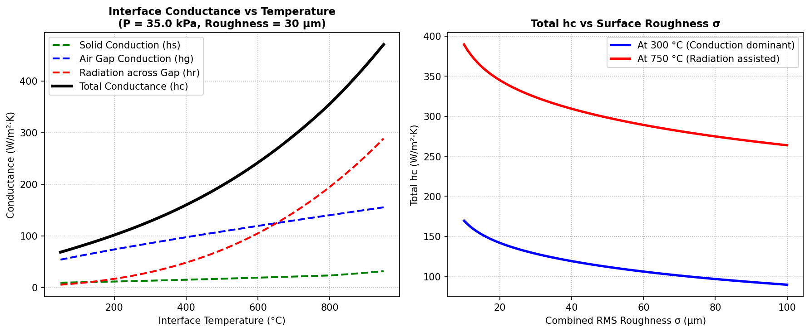
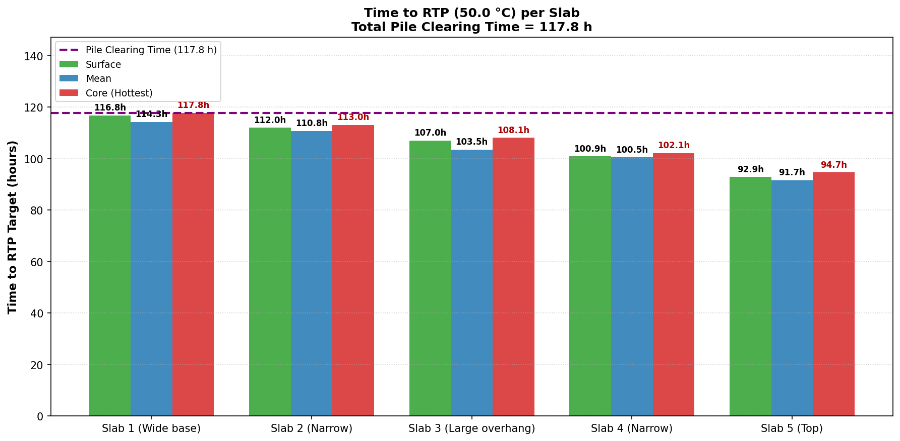

# Slab piling: how long a pile of hot slabs holds its heat

A slab yard is a queue. Slabs leave the rolling line at rolling temperature and have to sit in the open
until they are cool enough to handle, inspect or ship. Pile them too soon and the middle of the pile
stays hot for days. Pile them too late and the line backs up. This repository answers the yard's question
by solving the three dimensional transient heat conduction problem through the whole stack, with the
exposed surfaces, the weather, the ground and the jagged contact between one slab and the next treated as
the boundary conditions they really are.

Everything runs from one file: `from-other/slab_piling_thermal_standalone.ipynb`. The simulation engine,
about 2,500 lines, is carried inside the notebook itself, so it needs no module beside it. Open it in
Jupyter or Colab, run all cells, and the whole study reproduces: geometry, mesh, both orthogonal section
solves, the analytical verification, the figures and the uncertainty envelope.

## The pile this repository ships with

Five slabs of mixed size, all charged at 850 °C, standing in a 30 °C yard with a 0.8 m/s wind, a 25 °C
sky and a soil foundation 1.5 m deep. The yard releases the pile at an RTP target of 50 °C.

| Slab | Thickness mm | Width mm | Length mm | Charging temperature °C |
| ---: | ---: | ---: | ---: | ---: |
| 1 | 250 | 1600 | 9500 | 850 |
| 2 | 220 | 1400 | 9000 | 850 |
| 3 | 250 | 1800 | 10000 | 850 |
| 4 | 220 | 1350 | 8800 | 850 |
| 5 | 250 | 1500 | 9200 | 850 |

Total pile mass 134.5 t. The slabs are not identical on purpose. Lengths differ by more than a metre and
widths by tens of millimetres, so the stack has overhangs, and the code works out which cells touch, how
much of each footprint overlaps the one below, and what pressure each joint carries.

| Question | Answer |
| :--- | :--- |
| Time until the whole pile is below the 50 °C target | 118.2 h |
| Monte Carlo P10, fastest plausible release | 103.5 h |
| Monte Carlo P50, expected release | 114.5 h |
| Monte Carlo P90, release that holds up in the worst plausible case | 126.3 h |
| Energy balance error, width section | 0.92 per cent |
| Energy balance error, length section | 0.15 per cent |

Every slab follows the same shape and they are ordered by stack position. The top slab is free to radiate
to the sky and lose heat from its upper face, so it leaves the yard first. The bottom slab sits on the
soil, which is the one boundary that does not stay cold, and it is the one that sets the clock. The gap
between the first and the last curve is what a mixed pile buys and costs.

The two orthogonal sections at twelve hours. The width section cuts through thickness and width; the
length section cuts through thickness and length. Read together they show where the heat actually goes:
the ends of a slab are the only face a middle slab has, so heat has to travel along metres of steel to
reach the yard. That path, not the surface coefficient, sets the holding time.

## What the notebook computes, in order

Two section solves are run rather than one, because a slab pile is not axisymmetric. The width section
carries the overhang and the soil contact; the length section carries the long conduction path to the
ends. The reported holding time is the one that clears both.

## The governing relations, with their symbols

Energy balance inside the steel:

$$\rho(\theta)\, c_p(\theta) \frac{\partial \theta}{\partial t} = \nabla \cdot \left( k(\theta) \nabla \theta \right)$$

- $\theta$ temperature, °C; $t$ time, s
- $\rho(\theta)$ density, kg/m³, 7850 − 0.35 θ
- $k(\theta)$ conductivity, W/m/K, [1]
- $c_p(\theta)$ apparent specific heat, J/kg/K, [1]

Conductivity and specific heat come from the thermal properties of carbon steel in EN 1993-1-2 [1]:

$$k = 54 - 3.33\times10^{-2}\theta \ \ (20 \le \theta < 800\ ^\circ\text{C}), \qquad k = 27.3 \ \ (\theta \ge 800\ ^\circ\text{C})$$

$$c_p = 425 + 0.773\theta - 1.69\times10^{-3}\theta^2 + 2.22\times10^{-6}\theta^3 \ \ (20 \le \theta < 600)$$

$$c_p = 666 + \frac{13002}{738-\theta} \ \ (600 \le \theta < 735), \qquad
c_p = 545 + \frac{17820}{\theta-731} \ \ (735 \le \theta < 900), \qquad c_p = 650 \ \ (\theta \ge 900)$$

- the two peak branches are the steel losing its magnetic order between 600 and 735 °C, and they are why
  a hot slab stores as much heat as it does
- stored energy is tracked through the analytic antiderivative $h(\theta)=\int_0^\theta c_p\,d\theta$, so
  the energy ledger is exact across the peak instead of trapezoidal

Heat leaving an exposed face. Each boundary cell is a half cell of steel in series with the surface:

$$q = \frac{\theta_{cell} - \theta_{eff}}{\Delta/(2k) + 1/h_{total}}, \qquad
h_{total} = h_{conv} + h_{rad}, \qquad
\theta_{eff} = \frac{h_{conv}\theta_\infty + h_{rad}\theta_{rad}}{h_{conv} + h_{rad}}$$

$$h_{rad} = \varepsilon \sigma F \left(\theta_{cell,K}^2 + \theta_{rad,K}^2\right)\left(\theta_{cell,K} + \theta_{rad,K}\right)$$

- $\Delta$ cell size normal to the face, m; $A$ face area, m²
- $\varepsilon$ 0.82 for oxidised mill scale; $\sigma$ 5.670374 $\times$ 10⁻⁸ W/m²K⁴
- $F$ view factor, 1 for an exposed face to the sky, the parallel plate factor 1/(2/ε − 1) inside a gap
- $\theta_{rad}$ is the sky temperature for an up facing surface and the air for everything else
- all four temperatures in the radiation term are absolute, in kelvin, which is what makes the
  linearisation exact

Natural convection uses the standard correlations with air properties at the film temperature
$\theta_f = (\theta_s + \theta_\infty)/2$:

$$\overline{Nu}_L = \left[0.825 + \frac{0.387\,Ra_L^{1/6}}{\left[1 + (0.492/Pr)^{9/16}\right]^{8/27}}\right]^2
\ \ \text{(vertical)}$$

$$Nu = 0.54\,Ra^{1/4} \ \text{and}\ Nu = 0.15\,Ra^{1/3} \ \text{(up)}, \qquad Nu = 0.27\,Ra^{1/4} \ \text{(down)}$$

$$Ra_L = \frac{g\beta(\theta_s - \theta_\infty)L^3}{\nu^2}, \qquad h_{nat} = \frac{Nu\,k_f}{L}$$

- $h_{conv}$ convection coefficient, W/m²K; $L$ characteristic length, m
- $L$ is taken as the height of the exposed vertical wall on a side face, and as area over perimeter on a
  horizontal face, so a slab side and the pile side do not share a length
- $k_f$, $\nu$, $Pr$, $\beta$ at the film temperature: conductivity from tabulated air data [4], kinematic
  viscosity from Sutherland's law and the ideal gas density [5], $Pr$ = 0.71 [3], $\beta = 1/\theta_{f,K}$
- the vertical branch is the Churchill and Chu whole range correlation [2]; the two horizontal branches are
  the Incropera laminar and turbulent coefficients [3]

Wind. Free and forced convection combine in quadrature,
$h_{conv} = (h_{nat}^3 + h_{forced}^3)^{1/3}$, with $h_{forced} = 3.8\,V^{0.78}$ W/m²K for wind speed $V$
in m/s [8]. The flat plate correlation is deliberately not used here: with a fetch between 0.3 m and 10 m
it gives anything from 1.5 to 7 W/m²K at yard wind speeds, and a two dimensional section cannot say which
fetch applies. At 0.8 m/s the wind adds about 3 W/m²K on top of 8 W/m²K of natural convection, against
54 W/m²K of radiation at charge temperature, so the choice is not what sets the answer.

The joint between two slabs has three paths acting in parallel, and the whole assembly is in series with the oxide
scale on both faces:

$$h_c = \left[\frac{1}{h_s + h_g + h_r} + R_{scale}\right]^{-1}, \qquad
h_s = 1.25\,\frac{k_s\,m}{\sigma_a}\left(\frac{P}{H}\right)^{0.95}$$

$$Y = 1.184\,\sigma_a\left[-\ln\left(3.132\,\frac{P}{H}\right)\right]^{0.547}, \qquad
h_g = \frac{k_g}{Y + w}, \qquad
h_r = \sigma F \left(\theta_{1,K}^2 + \theta_{2,K}^2\right)\left(\theta_{1,K} + \theta_{2,K}\right)$$

$$P = \frac{\sum_{above} m_i g}{A_{overlap}}, \qquad H(\theta) = 1.5\,\text{GPa}\,\exp\left[-0.0022(\theta-20)\right]$$

- $h_s$ asperity contacts, $h_g$ conduction through the gas in the valleys, $h_r$ radiation across the gap,
  all W/m²K; $R_{scale}$ from the scale thickness and its conductivity
- $P$ contact pressure from the weight of everything above divided by the area that actually overlaps, Pa
- $H(\theta)$ hot hardness, Pa, falling as the steel softens [6], [7]
- $\sigma_a$ rms roughness, $m$ mean asperity slope, $w$ waviness gap, $k_g$ gas conductivity
- the edge draft term raises the gas path within 80 mm of an open edge, where the gap breathes to the yard

The joint is the part that decides whether a pile behaves as one body or as a stack of separate plates.
At charge temperature the three paths give a few hundred W/m²K, dominated by the gas path and the gap
radiation, and the conductance rises as the stack loads the lower joints and the steel softens. A pile
that is wrapped, or blocked with dunnage so the gaps cannot breathe, is not this pile.

Ground. The bottom slab rests on a soil layer of finite depth, solved as a stack of conduction cells
down to a fixed deep temperature, $q = k_{soil}(\theta_i - \theta_{i+1})/\Delta z$ with $k_{soil}$ = 1.4
W/m/K. The soil is the only boundary that cannot cool below the deep temperature, and in a long hold it
is why the bottom slab finishes last.

Numerics. The grid is rectilinear with local refinement through the thickness and in the overhang
zone. Each time step assembles one sparse linear system and solves it implicitly, which allows steps of
minutes and a week long cooling curve in seconds of wall clock. Stability is a property of the
linearisation, not of a Courant limit, so the step adapts to how fast the hottest cell is moving instead
of to the finest cell in the mesh.

## Verification before results

The notebook runs its checks before it reports anything, and prints them in the run:

| Check | What it compares against | Result on this pile |
| :--- | :--- | :--- |
| Plate cooled symmetrically by convection | the analytical Fourier series solution | maximum deviation 2.01 °C, rms 1.51 °C over the 850 to 50 °C range |
| Energy conservation, closed system | the analytic enthalpy ledger | cumulative error 0.0000 per cent |
| Energy balance, the real pile | boundary flux against stored energy | 0.92 per cent width section, 0.15 per cent length section |

A maximum deviation of 2 °C on an 800 °C working range is two and a half parts in a thousand, well inside
the uncertainty of the surface coefficients themselves.

## How the holding time moves with the yard

The Monte Carlo cell perturbs the parameters that are not measured on this steel, 20 Latin hypercube
samples per run: emissivity over 0.76 to 0.86, joint roughness and waviness, scale thickness, wind,
ambient temperature, ground conductivity and the contact conductance beneath the bottom slab. That gives the yard an envelope to plan
against instead of one number:

| Percentile | Clearing time h | What it means to the yard |
| :--- | ---: | :--- |
| P10 | 103.5 | fastest plausible release, the optimistic planner |
| P50 | 114.5 | expected release |
| P90 | 126.3 | the release that survives the worst plausible combination |

The spread between P10 and P90 is roughly a fifth of the holding time, and almost all of it comes from
the surface coefficients and the joint, not from the steel properties, which are known to a few per cent.

## What this model cannot settle

1. The joint conductance is a model inside the model. It rests on a roughness, a hardness and a contact
   fraction that are not measured on this steel. The uncertainty run shows what that costs.
2. The wind term is an engineering fit for low speed outdoor air, used because the real fetch and the
   free stream turbulence of a yard cannot be resolved in a two dimensional section. It is the largest
   single uncertainty in the surface physics.
3. The sky is represented by a single sky temperature. A clear night, clouds, or a south facing wall in
   the afternoon all move that number, and the solar term is present in the code but switched off in the
   shipped configuration.
4. The soil is a conduction layer at constant properties. Real ground warms through the season, and a
   pile standing on warm ground releases later than this.
5. No phase change below the transformation range, no scale growth during the hold, no wind gusts.
6. A slab is assumed to rest on the one below it. A slab bridging a gap that its neighbours do not fill
   would bend and carry a different contact pattern. The geometry can express that pile, the joint model
   cannot yet.

## Methods and tools

- Python 3.14 with numpy, scipy sparse, pandas, matplotlib and plotly. The solver is finite volume with
  an implicit sparse solve per step, which is why a five slab pile through a full cooling curve takes
  about ten seconds per section on a laptop.
- The engine is inlined into the notebook in eight cells, one per subsystem, so the notebook travels as
  a single file with no import path to break.
- Two section solves, thickness by width and thickness by length, are run and compared; the slower of the
  two clears the pile.
- Verification is executed, not asserted: the analytical plate solution, the energy ledger and the
  boundary flux balance are printed in the notebook's own output, and the figures are produced from the
  same run that the tables quote.
- To reproduce everything: open the notebook and run all cells. The only file it writes is
  `slab_pile_cooling_history.csv`, the cooling curve of every slab.

## References

[1] British Standards Institution, *BS EN 1993-1-2: Eurocode 3, Design of Steel Structures, Part 1-2:
General Rules, Structural Fire Design*. London, U.K.: BSI, 2005, clause 3.4.1.2 and Table 3.1.

[2] S. W. Churchill and H. H. S. Chu, "Correlating equations for laminar and turbulent free convection from
a vertical plate," *International Journal of Heat and Mass Transfer*, vol. 18, no. 11, pp. 1323-1329, 1975.

[3] F. P. Incropera, D. P. DeWitt, T. L. Bergman, and A. S. Lavine, *Fundamentals of Heat and Mass
Transfer*, 7th ed. Hoboken, NJ, USA: Wiley, 2011, ch. 9 and Table A.4.

[4] The Engineering Toolbox, "Air properties: thermal conductivity vs. temperature and pressure,"
atmospheric pressure table. [Online]. Available:
https://www.engineeringtoolbox.com/air-properties-viscosity-conductivity-heat-capacity-d_1509.html

[5] F. M. White, *Viscous Fluid Flow*, 3rd ed. New York, NY, USA: McGraw-Hill, 2006, Sutherland law for
the viscosity of air.

[6] M. G. Cooper, B. B. Mikic, and M. M. Yovanovich, "Thermal contact conductance," *International Journal
of Heat and Mass Transfer*, vol. 12, no. 3, pp. 279-300, 1969.

[7] C. V. Madhusudana, *Thermal Contact Conductance*, 2nd ed. Cham, Switzerland: Springer, 2014.

[8] American Society of Heating, Refrigerating and Air-Conditioning Engineers, *ASHRAE Handbook:
Fundamentals*. Atlanta, GA, USA: ASHRAE, 2017, ch. 4, surface heat transfer coefficients.

[9] H. S. Carslaw and J. C. Jaeger, *Conduction of Heat in Solids*, 2nd ed. Oxford, U.K.: Oxford University
Press, 1959, ch. 3, series solutions for the plate.

[10] J. Pullen, D. E. Williamson, and R. C. Woodgate, "Thermal contact conductance of rough steel surfaces
at low contact pressures," *Journal of Mechanical Engineering Science*, vol. 12, 1970.
